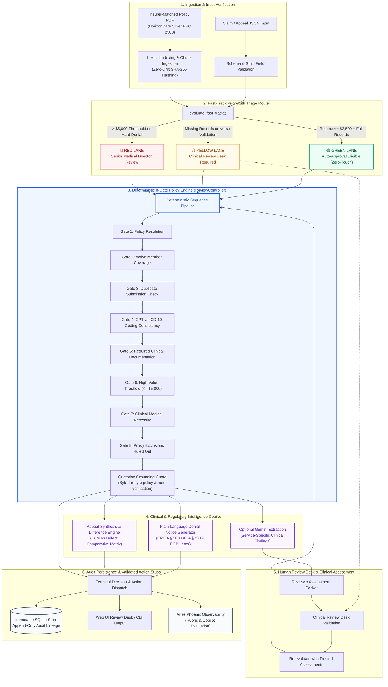

# Policy-Grounded Insurance Claims Agent & Review Engine

[](https://www.python.org/)
[]()
[-success.svg)]()
[-brightgreen.svg)]()
[]()

An enterprise-grade, policy-grounded autonomous claims review and pre-authorization engine tailored for the **HorizonCare Silver PPO 2500** benefit plan.

The system deterministically evaluates claims across 17 distinct service lines (MRI, CT, Ultrasound, Office/Specialist Visits, Outpatient Surgery, Inpatient Admissions, DME, Prescription/Specialty Drugs, Physical Therapy, and Mental Health) through an **8-Gate Deterministic Policy Pipeline**. It features a **Fast-Track Prior-Auth Triage Router**, ERISA § 503 / ACA § 2719 compliant **Adverse Determination Notices**, an **Appeal Synthesis Engine**, an interactive **Web Review Desk**, and an offline **Arize Phoenix Observability & Evaluation Suite**.

---

## ⚡ Quick Start (Run in Under 60 Seconds)

### Prerequisites
Requires Python 3.11+ (Python 3.12 recommended) and [uv](https://docs.astral.sh/uv/getting-started/installation/).

```bash
# 1. Enter the implementation directory
cd claims-agent

# 2. Synchronize dependencies (includes dev and web dependencies)
uv sync --locked --extra dev --extra web

# 3. Run the full test suite (141 tests, zero failures)
uv run --locked --extra dev python -m pytest -q

# 4. Ingest and index the HorizonCare Policy PDF
uv run --locked python -m claims_agent.cli ingest-policies

# 5. Launch the Web Review Desk UI
uv run --locked --extra web python -m uvicorn claims_agent.web:app --host 127.0.0.1 --port 8088
```

Open **http://127.0.0.1:8088** in your browser to interact with the Review Desk.

> [!NOTE]
> **100% Offline & Keyless**: No Gemini API key or external cloud credentials are required. The entire test suite, policy verification matrix, Arize Phoenix benchmarks, and the Web Review Desk (with its 18 pre-loaded synthetic clinical samples and mock extraction engine) run completely locally.

---

## 📂 Repository Structure

```text
├── README.md                                    <- Root Project Overview & Quick Start
├── AI_Claims_Agent_Implementation_Plan.md       <- Full Architecture, Gates, & Production Roadmap
├── AI_Claims_Agent_Collaborative_Coding_Prompt.md <- Development Specification & Evaluation Rubrics
├── AI_Engineer_Take_Home_Task.pdf               <- Original Engineering Assignment
├── Example_Policy_Document_HorizonCare.pdf      <- Ground-Truth HorizonCare Silver PPO 2500 PDF
├── test_set/                                    <- 18 Standardized Multi-Service Test Cases
├── claims-agent/                                <- Complete Python Implementation Package
│   ├── src/claims_agent/                        <- Core Engine Source Code
│   │   ├── adjudication/                        <- 8-Gate Adjudication Pipeline & ReviewController
│   │   ├── extraction/                          <- Gemini Live Adapter & Mock Extraction Engine
│   │   ├── indexing/                            <- Lexical Ingestion & Zero-Drift Policy Chunker
│   │   ├── notices/                             <- ERISA § 503 Adverse Benefit Notices & Appeals
│   │   ├── observability/                       <- Arize Phoenix Evaluation & Rubrics Suite
│   │   ├── triage/                              <- Fast-Track Prior-Auth Triage (Green/Yellow/Red)
│   │   ├── persistence/                         <- Immutable SQLite Audit Log & Lineage
│   │   ├── web.py                               <- FastAPI Web Review Desk Backend
│   │   └── static/                              <- Interactive Web Review Desk Frontend
│   ├── tests/                                   <- 141 Unit, Integration, & E2E Test Suite
│   ├── evaluation/                              <- Verification Datasets & Audit Reports
│   │   ├── audit-20261011-remediation/          <- 182/182 Audit Report & Evidence HTML/CSV
│   │   ├── policy_verification_51_cases.json    <- 51-Case Multi-Service Policy Verification
│   │   ├── phoenix_results.json                 <- 38-Case Arize Phoenix Benchmark Results
│   │   └── decision_cases.json                  <- Standard Adjudication Benchmark Scenarios
│   ├── docs/                                    <- Technical Architecture & Reference Guides
│   │   ├── architecture.md                      <- Architectural Decisions & Boundaries
│   │   ├── policy-coverage.md                   <- Comprehensive Benefit & Exclusions Matrix
│   │   ├── web-ui.md                            <- Web Review Desk Operator Manual
│   │   └── codes_and_determinations_reference.md<- CPT, ICD-10, & Action Code Manual
│   ├── pyproject.toml                           <- Package & Dependency Manifest
│   └── uv.lock                                  <- Deterministic Locked Dependencies
```

---

## 🏛️ System Architecture



---

## 🔬 Evaluation & Verification Highlights

| Evaluation Dimension | Scope & Details | Result |
| :--- | :--- | :---: |
| **Comprehensive Test Suite** | 141 automated unit, integration, and contract tests across all 8 gates | **141 / 141 Passed (100%)** |
| **Audit Remediation Suite** | 182 rigorous adversarial and live checks with bounded retry backoff | **182 / 182 Passed (100%)** |
| **Policy Matrix Verification** | 51 cases across 17 distinct service lines (Happy Path, Edge, Definite Failure) | **51 / 51 Passed (100%)** |
| **Arize Phoenix Observability** | 38 benchmark cases across 7 core metrics evaluating triage, grounding & robustness | **100% Core Alignment** |
| **ERISA § 503 Denial Notices** | Plain-language adverse determination letters generated for all denials | **Validated** |
| **Appeal Synthesis Engine** | Comparative diffing between original denial and new cure evidence | **Validated** |

Inspect detailed interactive reports:
- [Audit Remediation HTML Report](claims-agent/evaluation/audit-20261011-remediation/report.html)
- [Comprehensive Policy Matrix Comparison Report](claims-agent/docs/POLICY_SYSTEM_COMPARISON_AND_TEST_REPORT.md)
- [Phoenix Observability Benchmark Summary](claims-agent/evaluation/phoenix_results.json)

---

## 🖥️ Web Review Desk UI

The local web review desk provides an intuitive, high-visibility interface designed for clinical claims examiners:

1. **Quick-Load Sample Suite**: 18 pre-configured scenarios spanning standard pre-authorizations, complex DME claims, coding mismatches, missing clinical notes, appeals, and adversarial prompts.
2. **Fast-Track Triage Indicator**: Real-time visualization of Green Lane (auto-approval), Yellow Lane (clinical desk), and Red Lane (medical director).
3. **8-Gate Trace Inspection**: Interactive step-through of every policy gate with citations and byte-for-byte verbatim excerpts from the HorizonCare policy.
4. **Clinical Findings Review Packet**: Side-by-side human-in-the-loop validation of AI-extracted findings before committing determinations.
5. **ERISA Adverse Action Tab**: Real-time rendering of member-facing denial letters, appeal rights, and documentation curing instructions.
6. **Immutable Lineage History**: Full SQLite timeline preserving previous determinations, original denials, and appeal resolutions.

To launch:
```bash
cd claims-agent
uv run --locked --extra web python -m uvicorn claims_agent.web:app --host 127.0.0.1 --port 8088
```

---

## 🤖 Optional: Live Gemini AI Integration

To run live extraction against Google Gemini (`gemini-2.5-flash-lite`):
```bash
cd claims-agent

# Set your API key in .env or environment variable
echo "GEMINI_API_KEY=your_key_here" > .env

# Run a review with live LLM extraction
uv run --locked --extra gemini --env-file .env python -m claims_agent.cli review \
  --input evaluation/extraction/L01.json \
  --llm gemini \
  --document NOTE1 \
  --format human
```

*Note: Live LLM extraction adheres to strict clinical bounding: model extractions are presented as untrusted candidate findings and must be confirmed by a clinical reviewer before any authorization can proceed.*

---

## 📜 License & Compliance

Built for enterprise healthcare evaluation. Designed to uphold strict zero-drift reproducibility, ERISA § 503 / ACA § 2719 regulatory transparency, and audit immutability.
