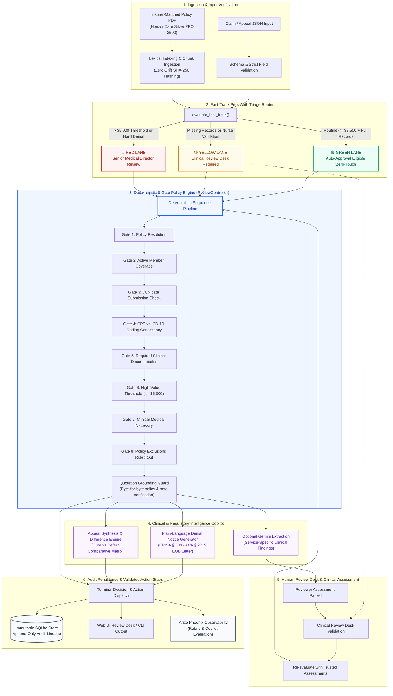

# Policy-grounded claims agent

A runnable Python prototype for policy-wide HorizonCare Silver PPO 2500
pre-authorization, payment and appeal review. It retrieves evidence from the
supplied policy PDF, applies deterministic rules, and returns one of six validated
action stubs with reasons and page/section citations. Optional Gemini extraction
provides clinical findings that a reviewer can explicitly assess before rerunning
the decision in a new, auditable review.

## Setup

Requires Python 3.11+ and [uv](https://docs.astral.sh/uv/getting-started/installation/).
Run commands from this directory after extracting the submission. Exact dependency
versions are in `uv.lock`; `.python-version` selects Python 3.12 for the documented
setup. `uv` may download that interpreter and public Python packages if absent.

```sh
uv sync --locked --extra dev
uv run --locked --extra dev python -m pytest -q
uv run --locked python -m claims_agent.cli ingest-policies
uv run --locked python -m claims_agent.cli review --input examples/covered_mri.json --format human
```

No API key is required for ordinary reviews, mocks, or offline evaluation. Tested
on macOS with Python 3.12.13. Other operating systems and Python versions are not
verified. SDK-dependent tests skip without the Gemini extra; the web test module skips
without the web extra.

## Browser interface

Start the local review desk from this directory with one command:

```sh
uv run --locked --extra web python -m uvicorn claims_agent.web:app --host 127.0.0.1 --port 8000
```

Open **http://127.0.0.1:8088**. Load a sample or upload claim JSON, run the rules
or recorded Gemini demo, inspect citations, assess clinical findings and view
linked history. The recorded demo needs no key. For a live call, start with:

```sh
uv run --locked --extra web --extra gemini --env-file .env python -m uvicorn claims_agent.web:app --host 127.0.0.1 --port 8000
```

Follow the [web walkthrough](docs/web-ui.md). This is a local, single-operator
demonstration; the CLI remains available for automated testing. Prepared appeal
JSON can also be submitted in the UI against its saved denial history.

## Policy-wide services

The agent now supports MRI across anatomical regions, CT, ultrasound, office and
specialist visits, outpatient procedures, emergency services, inpatient admissions,
DME and prescription/specialty drugs. The browser sample menu covers these families.
CT emergency exceptions, elective admissions, DME's strict $500 PA threshold and
formulary-based drug requirements are evaluated separately. Missing external facts
route for review; a real formulary and benefit calculation are not invented.

See the [complete policy coverage matrix](docs/policy-coverage.md),
[codes, schema and determinations reference manual](docs/codes_and_determinations_reference.md), and
[23 service scenarios](examples/services/README.md). Run the added evaluation:

```sh
uv run --locked python -m claims_agent.cli evaluate-services
```

## Reviewer demo

| Command input | Expected action |
| --- | --- |
| `examples/covered_mri.json` | approve_pre_authorization |
| `examples/missing_document.json` | request_missing_documentation |
| `examples/high_value.json` | route_to_senior_reviewer |
| `examples/covered_payment.json` | approve_claim_payment, $900 from supplied calculation |
| `evaluation/cases/D02.json` | deny_claim for inactive plan |
| `evaluation/cases/D07.json` | route_to_coding_review |
| `evaluation/cases/D10.json` | deny_claim despite instructions injected in notes |

```sh
uv run --locked python -m claims_agent.cli review --input examples/missing_document.json
uv run --locked python -m claims_agent.cli review --input examples/covered_payment.json --format human
uv run --locked python -m claims_agent.cli evaluate
```

JSON is the default format. Review output contains `cli_schema_version`, `decision`,
`advisory`, and `persistence`. The decision contains `action`, `arguments`, `mode`,
and an immutable `context` with the reason, missing/unresolved information,
citations and ordered rule trace. The payment example's action arguments are:

```json
{"payment_in_dollars": 900.0}
```

All examples are synthetic. Approval examples explicitly supply trusted clinical,
coding and benefit assessments; they do not imply autonomous medical inference.
See the [complete walkthrough](examples/README.md) for mock extraction and the
saved-denial/appeal flow. Ordinary reviews save only with `--save`. Appeals save
only after verifying the stored prior link. Reused review IDs cannot overwrite history.

Exit codes: 0 for a completed review (including denial/routing/document requests),
2 for invalid arguments or input, 1 for operational/evaluation failure. Optional
model failure is reported separately and does not invalidate a completed decision.

## Actual Gemini use

The adapter uses **`gemini-3.5-flash-lite`** through the optional `google-genai` SDK.
It extracts service-specific findings with exact document/policy quotations. MRI
uses diagnosis, necessity and treatment alternatives; CT adds emergency status;
inpatient adds elective status; drugs add formulary and specialty findings. Local checks validate the
response schema, input binding and quotations; they do not establish clinical truth.

Create a local `.env` from `.env.example` and set your own `GEMINI_API_KEY` there,
or set that variable directly in your process environment. Never share your key.
The application does not automatically read `.env`; the following commands ask
`uv` to load it explicitly. Preview is local; review makes a real Google API call.

```sh
uv sync --locked --extra dev --extra gemini
uv run --locked --extra gemini --env-file .env python -m claims_agent.cli review --input evaluation/extraction/L01.json --llm gemini --document NOTE1 --preview-llm-input
uv run --locked --extra gemini --env-file .env python -m claims_agent.cli review --input evaluation/extraction/L01.json --llm gemini --document NOTE1 --format human
```

If your key file is elsewhere, change the `--env-file` path. The L01 input has no
trusted clinical assessments, so the deterministic decision remains senior review
alongside the real extracted findings. **Model findings are not automatically
converted into trusted assessments or used to authorize claims.**

The model receives selected synthetic clinical text, notes and retrieved policy
excerpts; structured identities, history and payment amounts are omitted. Free
text is not automatically de-identified. Free-tier eligibility, quota and data-use
terms depend on your Google project and region. See [Google's pricing](https://ai.google.dev/gemini-api/docs/pricing)
and [terms](https://ai.google.dev/gemini-api/terms). A key alone never enables calls.
No model tools or billing changes. The adapter includes a bounded exponential backoff retry engine for transient provider errors (HTTP 429 rate limit, 5xx, timeouts, connection drops) with Google `RetryInfo` backoff delay parsing (up to 3 retries, 90s timeout budget).

## Reviewer-confirmed Gemini findings

Run `prepare-assessment` to create a source-bound packet and an unreviewed form.
The reviewer assesses all predicates for the selected service, provides reasons and exact source
quotes, and explicitly selects any existing assessments to carry forward.
`review-assessment` validates that response, creates a new clinical assessment,
reruns the deterministic rules and saves both reviews with the original extraction.
No finding starts preapproved: `documented` can describe a negative statement too.

The [complete confirmation demo](examples/clinical_review/README.md) runs offline
using a recorded real Gemini response, or with a fresh live call using your key.
It demonstrates senior routing before review and approval after **synthetic**
reviewer confirmation when the other prerequisites are satisfied. The same bridge
supports all supported service profiles; authorization and payable-amount gates still apply.

## Architecture and rules



Ordinary review order: input/policy, inactive plan, duplicate, coding, required
documents, billed amount strictly above $5,000, clinical/exclusion checks, and
workflow-specific authorization/payment checks. Earlier applicable outcomes take
precedence. Exactly $5,000 clears only the amount gate, not all approval criteria.

Appeals first verify the saved denial, required appeal documents, documented
0–180-day timing and relevant new evidence, then reassess the original workflow.
Unresolved facts route to review; absence of evidence is not a negative finding.
The policy's “may be upheld” does not mandate automatic appeal denial.

The [concise architecture note](docs/architecture.md) covers design choices,
failure boundaries, and enterprise data architecture. The [implementation reference](docs/implementation-reference.md)
contains the detailed contracts, schemas, and controller execution rules.

## Evaluation and verification

- [Full System Audit Remediation](evaluation/audit-20261011-remediation/report.html): **182/182 test checks passed (100.0% Pass Rate)** with 0 failures and 0 unavailable cases, resolving all 14 previous failures and 11 rate-limited cases from `audit-20261011`. Includes 28/28 live Gemini calls passing with full grounded citations and bounded retry backoff.
- [Comprehensive Policy Verification](docs/POLICY_SYSTEM_COMPARISON_AND_TEST_REPORT.md): **51/51 test cases pass (100.0%)** across 17 distinct service lines and policy processes, testing a Happy Path, an Edge Case, and a Definite Failure case for each. Full machine-readable results are archived in [evaluation/policy_verification_51_cases.json](evaluation/policy_verification_51_cases.json).
- [Arize Phoenix Local Evaluation Engine](evaluation/phoenix_results.json): **35 cases evaluated across 7 core metrics (100% offline, zero cloud API keys required)**:
  - `FastTrackAlignment`: **100.0% Pass Rate** (triage alignment across Green, Yellow, and Red lanes)
  - `AdverseNoticeFidelity`: **100.0% Pass Rate** (plain-language ERISA/ACA denial letters generated only for actual denials)
  - `HumanCalibration`: **100.0% Pass Rate** (calibrated escalation of ambiguous clinical criteria to human review desk)
  - `ActionCorrectness`: **100.0% Pass Rate** (ground-truth adjudication accuracy)
  - `ProvenanceGrounding`: **100.0% Pass Rate** (complete citation grounding in policy chunks)
  - `WayOutCompleteness`: **94.3% Pass Rate** (actionable missing documentation or clinical remedy gates provided)
  - `AdversarialRobustness`: **94.3% Pass Rate** (resilience against prompt injection attacks)
- [Offline results](evaluation/results.md): 20/20 decision cases pass; all six mock extraction cases pass. Mock results do not measure Gemini quality.
- [Live verification](evaluation/live-verification.md): real Flash-Lite responses passed 6/6 cases, 24/24 topic labels and 14/14 quotation anchors. Earlier model, credential and overload failures remain documented separately.
- **141 comprehensive tests passed** (`pytest tests/ -v`), split across focused, maintainable test files:
  1. `tests/test_policy_scenarios.py` (54 tests): Complete policy test suite across all 17 claims categories (Happy Path, Edge Case, Definite Failure) plus clinical assessment copilot alignment tests.
  2. `tests/test_architecture_end_to_end.py` (44 tests): Complete end-to-end architectural test suite covering all 7 pipeline layers (PDF ingestion & evidence grounding, deterministic precedence, core workflows, payment & negative-integer guards, appeals & SQLite trigger immutability, AI advisory boundary & human review gate, Web API security & CSP, fast-track triage, and ERISA adverse determination notices).
  3. `tests/test_audit_remediation.py` (20 tests): Independent boundary tests verifying identity binding, stale review detection, and strict schema validation.
  4. `tests/test_live_extraction_remediation.py` (14 tests): Live extraction remediation tests verifying layout normalization, bounded exponential backoff retries, and Google RetryInfo delay handling.
  5. `tests/test_trust.py` (9 tests): Runtime evidence reliability and provenance scoring rubric tests.

```sh
# Run the complete test suite (141 tests):
uv run --locked --extra dev --extra web --extra gemini python -m pytest tests/ -v

# Run the policy scenarios suite (54 tests):
uv run --locked --extra dev python -m pytest tests/test_policy_scenarios.py -v

# Run the end-to-end architectural test suite (44 tests):
uv run --locked --extra dev --extra web python -m pytest tests/test_architecture_end_to_end.py -v

# Run the 182-check comprehensive system audit:
uv run --locked --extra dev --extra web --extra gemini python scripts/audit_system.py
uv run --locked --extra dev --extra web --extra gemini python scripts/audit_boundaries.py

# Run automated UI endpoint test suite (18 scenarios):
uv run --locked python scripts/test_ui_endpoints.py

# Run standalone verification and Arize Phoenix evaluation:
uv run --locked python scripts/verify_all_policy_cases.py
uv run --locked python scripts/phoenix_eval.py
uv run --locked python -m claims_agent.cli evaluate
# Optional live evaluation, using your key:
uv run --locked --extra gemini --env-file .env python -m claims_agent.cli evaluate --mode gemini
```

Live reports have unique timestamped names; offline evaluation replaces its latest `results.md` and `results.json`. All synthetic evaluation cases demonstrate software behaviour, not real medical sufficiency or population safety estimates. See [evaluation details](evaluation/README.md).

## Limits, trust and production next steps

The highest-risk failure is treating plausible text or an exact quote as a true,
sufficient clinical finding. LLM candidates require explicit reviewer assessment before becoming decision inputs.
Trusted assessments and structured claim facts are assumed authentic; source
labels alone do not establish that trust. Production needs authenticated reviewer
sign-off, assessment provenance and clinical validation before automating more.

Only the supplied plan and the documented symbolic service profiles are supported. There is no CPT lookup, six-week treatment rule, fixed $1,200
payment cap, or benefit calculator. Payment consumes a supplied trusted amount
and rejects amounts above the bill as an explicit MVP guard. Policy-specific
rule checks require review when the policy changes. Lexical retrieval has no
semantic understanding, and PDF ingestion has no OCR.

SQLite history has append-only application/trigger guards, but local file owners
are trusted. It is not encrypted or tamper-proof and does not serialize an entire
review against concurrent submissions. Logs/reports contain synthetic full inputs.
Real deployment needs access controls, encryption, retention rules, revision
archiving, transactional claim coordination, observability, larger evaluations,
quota handling and service-specific rule expansion. All six actions are stubs;
no money moves and no insurer system is modified.

## AI-assisted development and submission

Codex assisted with implementation, tests, debugging, documentation and evaluations.
Generated changes were checked against the policy and approved design, exercised
by unit/integration tests, verified through CLI commands, and tested against live
Gemini responses. Live testing exposed an obsolete model, a rejected key and
provider overload; these failures were retained rather than counted as passes.

The corrected [system/testing guide](SYSTEM_EXPLANATION_AND_TESTING_GUIDE.md)
provides a short interview walkthrough. To produce a local submission archive:

```sh
uv run --locked python scripts/build_submission.py
```

The archive excludes credentials, virtual environments, caches and review databases.
It includes source, tests, policy PDF, examples, lockfile, documentation and reports.
No publishing, repository push or deployment is performed.

The [final delivery review](docs/final-review.md) maps the delivered milestones,
policy extensions, and audit remediations to verified features.
